# Sakiyomi (先読み)

*Sakiyomi* ("reading ahead") is a desktop shogi GUI for Windows, built with Tauri 2 (Rust backend, React + TypeScript frontend).
It runs any USI engine. Its standard format is **SPG (Shogi Position Graph) v1.0**, which stores game records
and opening books as one position graph; Sakiyomi contains the format's reference implementation
([crates/spg](crates/spg)). The specification and the reference implementation are also published on their
own at [ikuto32/spg](https://github.com/ikuto32/spg). It also reads and writes the files other shogi programs use — KIF, KI2, CSA and JKF
records, YaneuraOu / ShogiGUI / Gikou opening books, and the hcpe / psv / hcpe3 training databases — so engines,
games and books move freely between Sakiyomi, ShogiGUI, Shogidokoro, ShogiHome and the engine toolchains.

Everything the GUI converts or mines is also available from the command line as `sakiyomi-tool`.

Licensed under the [MIT License](LICENSE).

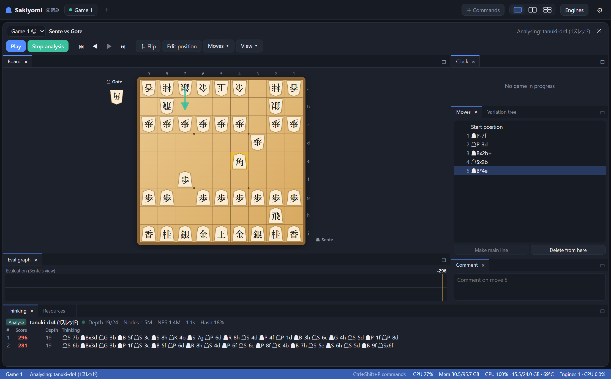

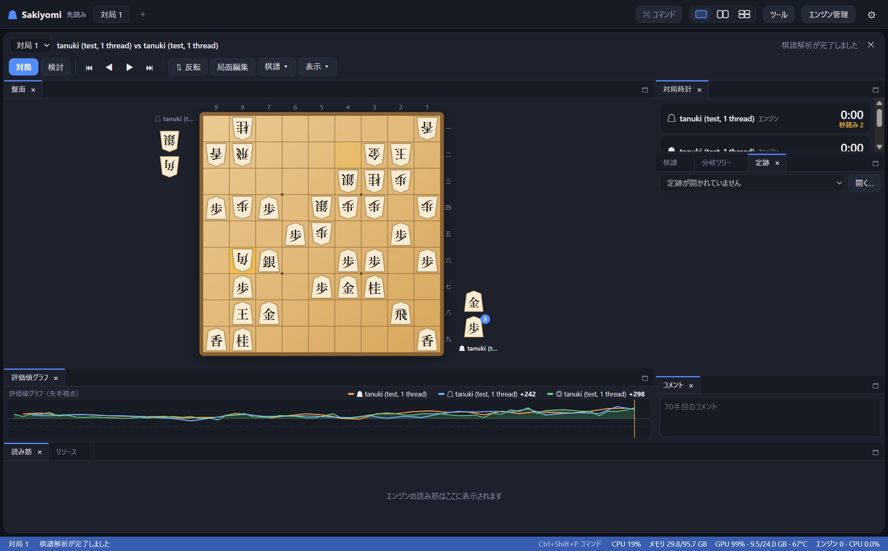

## Features

### Playing and analysing

- **USI engines**: register any `.exe`; Sakiyomi reads its `id` and `option` lines. Options are edited in a
  dialog and saved per engine. Only values that differ from the engine's defaults are sent, plus
  `USI_Hash`/`USI_Ponder`. The app runs `isready`/`usinewgame`, `position … moves`,
  `go btime/wtime/byoyomi`, `binc/winc`, `nodes`, `depth` and `infinite`, `stop`, `gameover` and `quit`.
  Engines are started directly (no shell), and every line they send is length-limited.
- **Play modes**: human vs engine, engine vs engine and human vs human. Each side has its own time
  control: main time + byoyomi, Fischer increment, or a node budget. Games end on checkmate, resignation,
  time loss, sennichite, perpetual check, an illegal move, entering-king declaration (`bestmove win`) or
  the move limit.
- **Analysis**: `go infinite` with MultiPV (1–20) on the displayed position. Each line shows score
  (from Sente's side), depth/seldepth, nodes, NPS, time and hashfull, and the PV in Japanese, Western or USI
  notation. **Batch analysis (棋譜解析)** walks the main line at N seconds per move.
- **Evaluation graph with every engine's reading**: each move keeps the reading of the engine playing Sente
  (☗, orange), the engine playing Gote (☖, blue) and the analysis engine (◎, green), all from Sente's point of
  view. Two engines that disagree show up as two separate lines. Click a legend chip to hide or show a line,
  or click the graph to jump to a move.
- **Multi-view (1, 2 or 4 panes)**: each tab is an independent session with its own record, clocks and
  engine processes, so several games and analyses run at once. Engines are bound to a session explicitly;
  hovering over a pane never switches engines or input.

| Engine vs engine: Sente's and Gote's readings | Book panel |
|---|---|
| 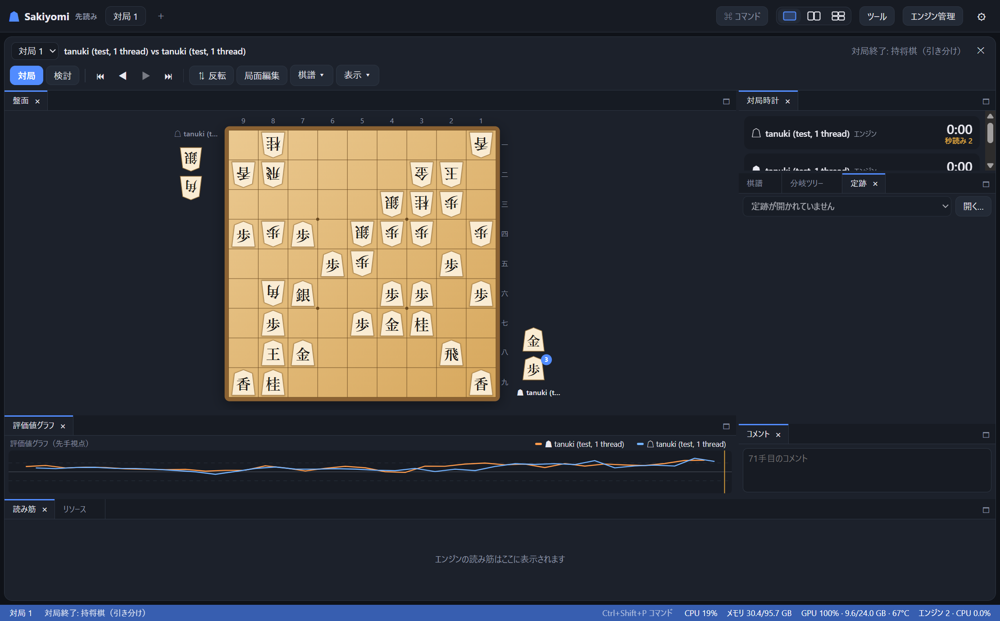 | 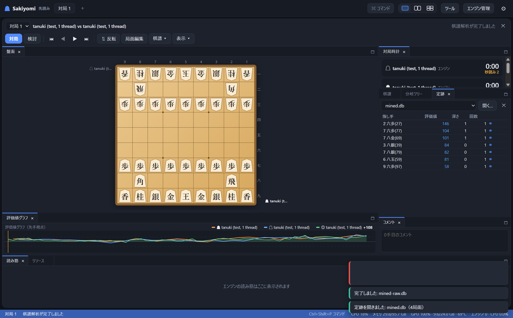 |

### SPG, the standard format

- **Records and books in one format.** `.spg` is a binary container: positions are stored as a 256-bit
  canonical code (CPE) under an XXH3 key, books as move edges with evaluations, weights and statistics, and
  game records as move trees over the same positions. `.spgt` is the line-based text form for diffs and
  hand edits. `.spgm` bundles large books into 256 shards with a signed manifest.
- **The default for saving** (棋譜 → SPG形式（標準）で保存…, `Ctrl+S`). A game is saved as a small records-only file: about 1.6 KB for a short game, and
  about 15 KB for a 70-move engine game with every reading. Comments, consumed time, variations, end-of-game events, header items, and both engines' readings
  (evaluation, depth, nodes, time, PV) are kept exactly. A file with several games opens each game in its own
  session.
- **Lossless imports** (§10 of the spec). Book columns that have no SPG field keep their original value
  under `src.*` keys (e.g. `src.yane.count`, `src.yane.ply`), so YaneuraOu's `.db` → SPG → `.db`
  reproduces the file byte for byte. Scores read from ShogiGUI, ShogiHome or Floodgate comments are stored as
  written and marked "viewpoint unknown", as the specification requires.
- **Data the GUI cannot show**, such as bookmarks, rights entries and extension annotations, is named in a
  notice when the file is opened. It is not saved back silently.
- **Integrity**: every read is a full verification (block checksums, invariants, legality of every move),
  and the header and directory are kept twice at the end of the file. With `--blk3` and `--sign-key`,
  file sets are protected by BLAKE3 Merkle roots and an Ed25519 signature. See [crates/spg](crates/spg),
  [the specification](crates/spg/spec/SPG-v1.0.md) and [the implementation notes](crates/spg/SPEC-NOTES.md).

### Records

- KIF (Shift_JIS `.kif` / UTF-8 `.kifu`), KI2, CSA (V2.2/V3.0), JKF (JSON Kifu Format) and USI
  `position` strings, with handicaps (手合割), BOD diagrams, comments, consumed time and variations (変化,
  in Kifu for Windows order).
- **Engine evaluations and PVs survive a save**: they are written as comments in the style you choose
  (設定 → 評価値・読み筋の保存形式) and recognised in every style when reading:

  | Style | Example | Used by |
  |---|---|---|
  | ShogiGUI | `**解析 0 ○ 時間 00:01.2 深さ 18/25 ノード数 123456 評価値 85 読み筋 ▲２六歩(27) …` | ShogiGUI, Shogidokoro (reads) |
  | ShogiHome | `*#評価値=85` / `*#読み筋=▲２六歩△８四歩…` | ShogiHome |
  | Floodgate | `'** 85 +2726FU -8384FU …` | CSA servers, Floodgate logs |

- Copy or paste a whole record, an SFEN, a `position …` string or a BOD diagram through the clipboard, or drop
  a file onto a pane.
- **Move list with variations**: a line view with a branch selector and a full branch tree (分岐ツリー). Promote
  a variation, delete from a move onward, edit per-move comments. `←` `→` `↑` `↓` `Home` `End` navigate.
- **Board editing (局面編集)**: piece palette, move/promote/flip pieces, edit both hands, side to move, and send
  the remaining pieces to Gote's hand for tsume problems.

### Opening books

- **Book converter (ツール → 定跡変換)**, the BookConv equivalent: YaneuraOu `.db` ⇄ ShogiGUI `.sbk` ⇄
  Gikou `book.bin`, any direction. Several inputs are merged (add counts / keep first / prefer later), and
  the result can be filtered by count, score drop from the best move, ply, side to move and moves per
  position. Values can be backed up through the book by minimax ("peta shock") before writing.
  A merge written to SPG records every input book as a source and, for each position and move, which
  sources contained it with their own values (PROV, spec §8.4), plus the union of their authors' rights.
  PROV costs 64 bytes per contribution; leave it out only on purpose (「由来情報（PROV）を書かない」,
  `--no-prov`).
  - The report tells you what the target format cannot hold (e.g. `.sbk` has no move depths) and how many
    entries were dropped as illegal, so nothing is lost silently.
  - Gikou books store only hash keys, so they are read by walking from known positions: the initial position,
    `--root` positions, or every position of another book (`--roots-from`, "技巧定跡の起点").
- **Book panel (定跡 tab)**: open any number of books and see the stored moves, scores, depths and play counts
  for the displayed position (colour-flipped positions too). Click a move to play it.
- **Book miner (ツール → 定跡掘り)**, BookMiner-style: leaf positions are searched with MultiPV (widened while
  the candidates are close), scores are backed up by minimax, and the next leaves are chosen where the book
  side plays its best move and the opponent any move within a score margin. Several engine processes work in
  parallel. The raw book is saved after every round, so a run can be stopped and continued; a playable book
  with backed-up values is written at the end.

| Book converter | Book miner (running) |
|---|---|
| 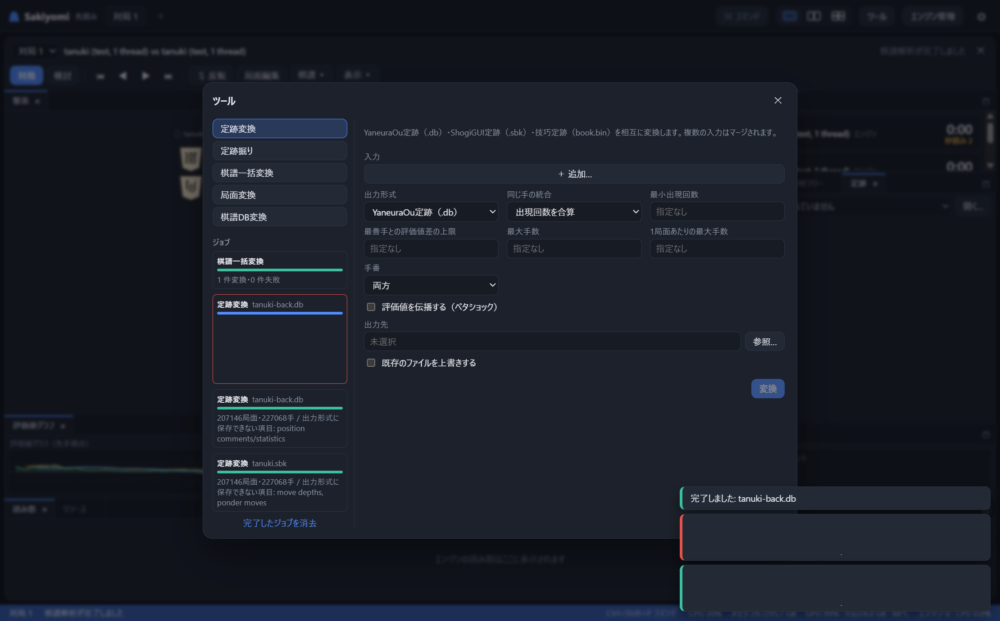 | 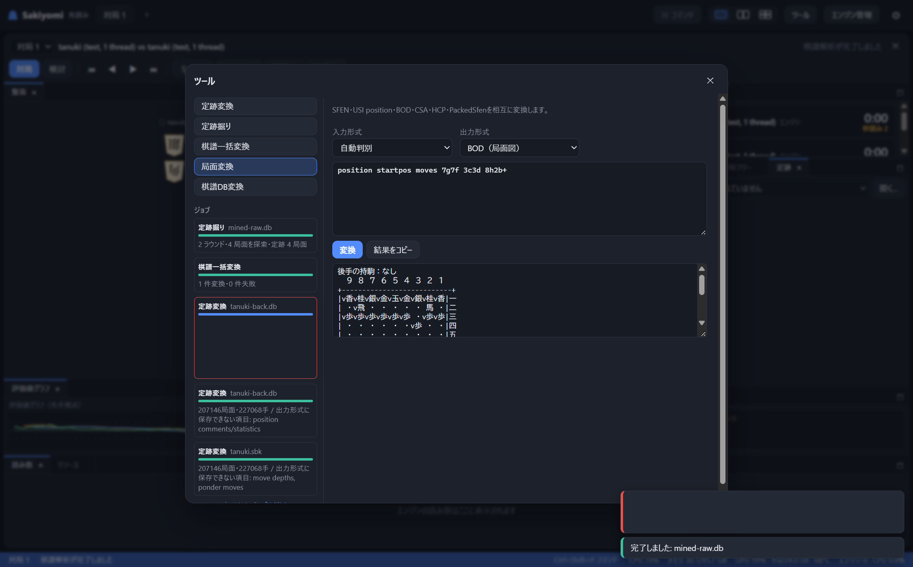 |

### Positions and databases

- **Position converter**: SFEN ⇄ USI `position` ⇄ BOD ⇄ CSA ⇄ HCP (cshogi `HuffmanCodedPos`, hex) ⇄
  PackedSfen (YaneuraOu, hex), with format detection.
- **Database converter**: hcpe (cshogi), PackedSfenValue (`.bin`), hcpe3 (DeepLearningShogi), SFEN game lines
  and multi-game CSA. Game formats convert to position formats with evaluations, optionally skipping positions
  without a score or before a ply. Files of any size are streamed.
- **Batch record converter**: many KIF/KI2/CSA/JKF/USI files into one folder, choosing format, encoding and
  evaluation-comment style.

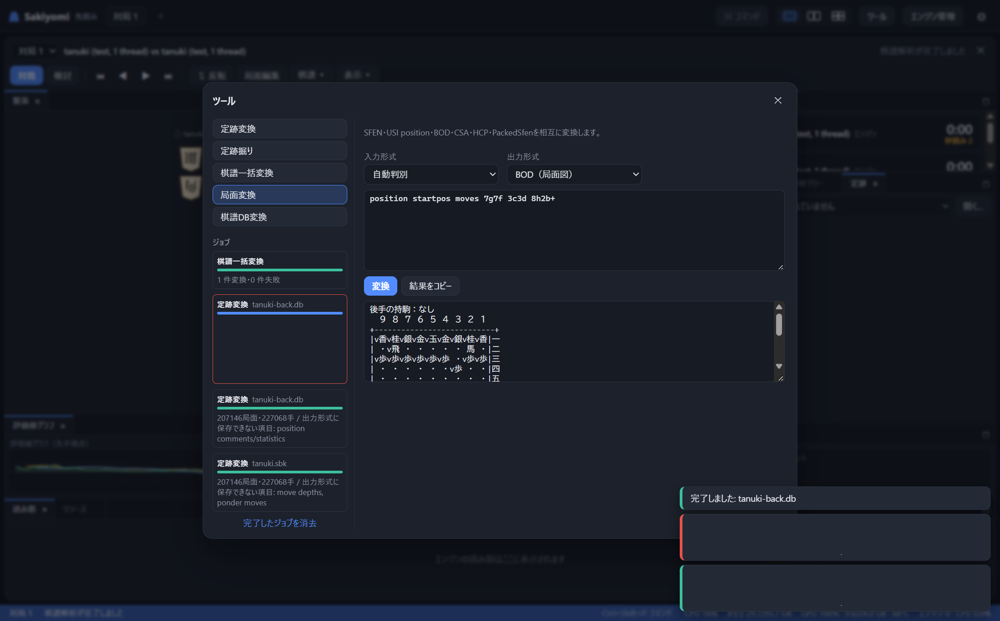

### Interface

- **Japanese and English UI**, following Windows by default. Move notation: Japanese (▲７六歩), Western
  (☗P-7f, ☖Bx2b+, ☗G6i-5h, ☗N-3c=) or USI (7g7f).
- **VS Code-like dock**: board, move list, branch tree, eval graph, thinking, clocks, comment, book and resources
  are tabs you can drag to split or stack, resize, maximize and close; presets and per-view layouts are saved.
- **Command palette** (`Ctrl+Shift+P` / `F1`) and shortcuts:

  | Keys | Action |
  |---|---|
  | `Ctrl+Shift+P` / `F1` | Command palette |
  | `Ctrl+J` / `Ctrl+B` | Toggle 読み筋 / 棋譜 |
  | `Ctrl+1`–`Ctrl+4` | Focus view 1–4 |
  | `Ctrl+T` | New tab |
  | `Ctrl+O` / `Ctrl+S` | Open / save |
  | `Ctrl+V` | Paste a record or position |
  | `Ctrl+=` / `Ctrl+-` / `Ctrl+0` | Zoom (add `Shift` for text size) |

- **Appearance**: system/dark/light theme, accent and board colours, piece typeface, one- or two-character
  pieces, text size and zoom. Piece stands are point-symmetric.
- **CPU / GPU usage** in the status bar and the リソース view (per-engine CPU, memory, GPU and VRAM via NVML).

| Rearranged dock | 4 views | Light theme |
|---|---|---|
| 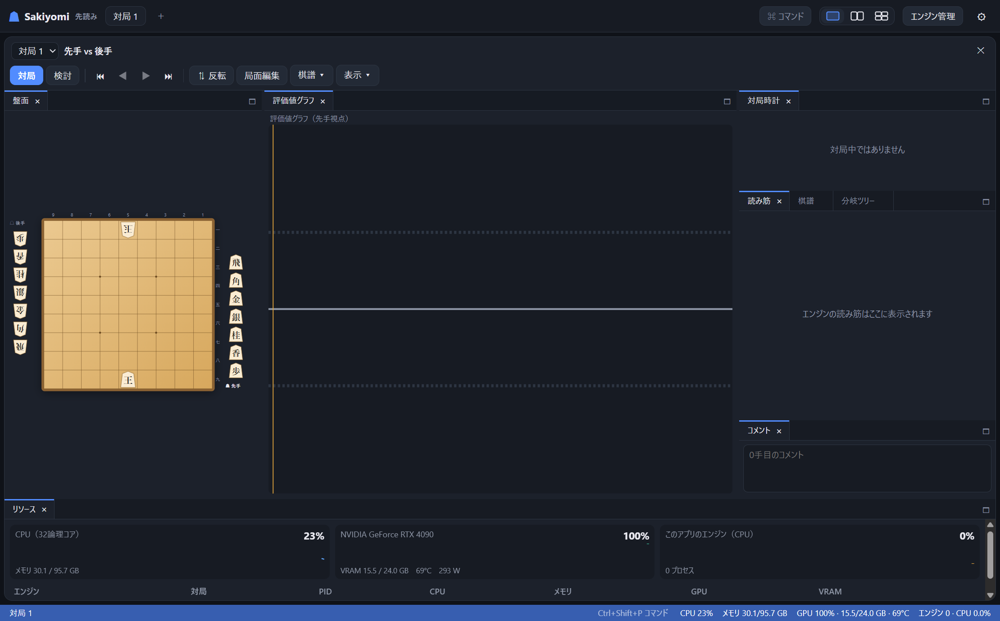 | 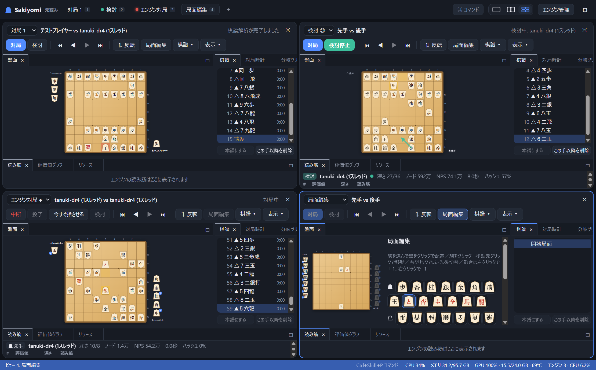 | 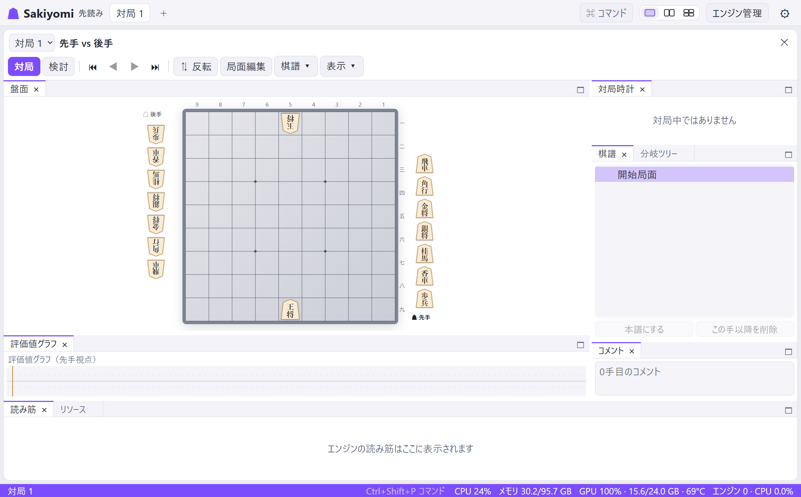 |
| **Settings** | **Human vs engine** | **Engine options** |
| 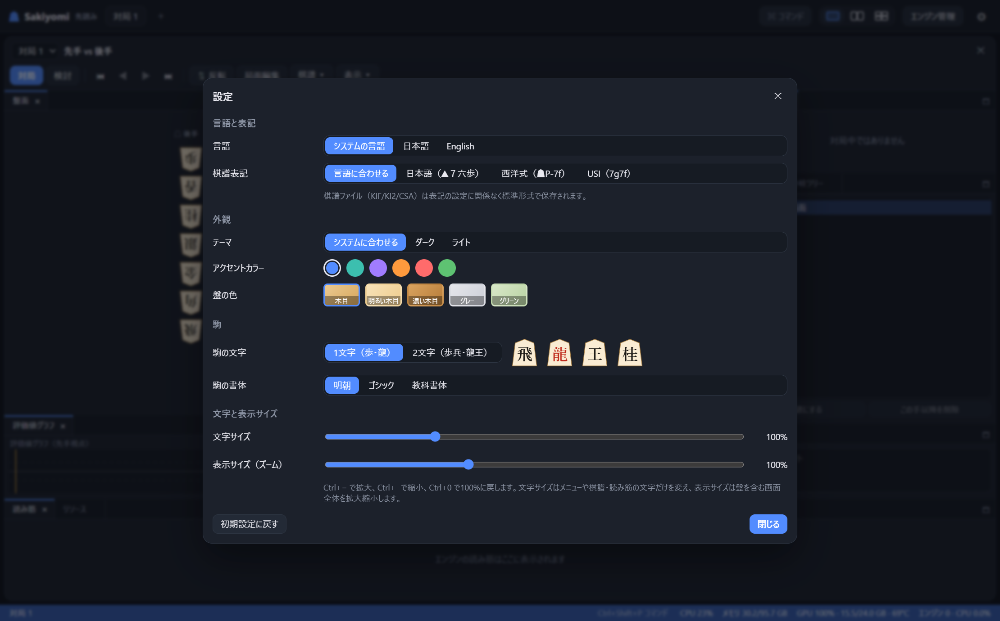 | 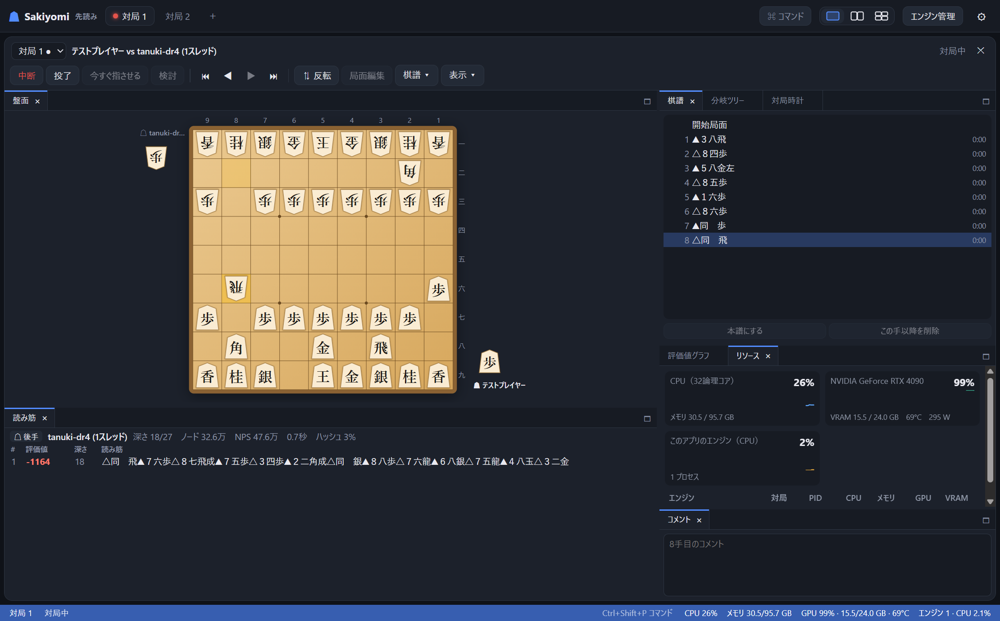 | 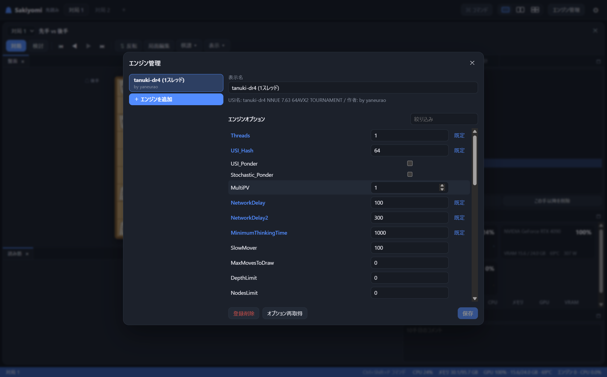 |

## Command line: `sakiyomi-tool`

```bash
cargo build --release -p sakiyomi-cli
```

```text
sakiyomi-tool spg verify book.spg
sakiyomi-tool spg convert book.spg -o book.spgt
sakiyomi-tool spg convert book.spg -o set/book.spgm --split --sign-key key.bin
sakiyomi-tool spg info book.spg
sakiyomi-tool spg probe book.spg "lnsgkgsnl/1r5b1/ppppppppp/9/9/2P6/PP1PPPPPP/1B5R1/LNSGKGSNL w -"
sakiyomi-tool book convert user_book1.db -o book.spg
sakiyomi-tool kifu convert games/*.kif --out-dir out --to spg
sakiyomi-tool db convert games.sfen -o games.spg --to spg
sakiyomi-tool book convert a.sbk b.db -o merged.db --min-count 2 --back-up
sakiyomi-tool book convert book.bin -o book.db --roots-from original.db
sakiyomi-tool book stats book.db
sakiyomi-tool book mine --engine engine.exe --option Threads=4 --workers 2 --nodes 1000000 -o raw.db --book book.db
sakiyomi-tool kifu convert games/*.kif --out-dir out --to csa --eval floodgate
sakiyomi-tool position convert "position startpos moves 7g7f" --to hcp
sakiyomi-tool db convert games.hcpe3 -o train.hcpe --to hcpe --skip-without-eval
```

Existing outputs are never replaced without `--force`. `sakiyomi-tool <command> --help` lists every option.
Messages are in English unless `SAKIYOMI_LANG=ja` (or a Japanese `LANG`) is set.

## Design

See [ARCHITECTURE.md](ARCHITECTURE.md). In short:

```
spg (SPG v1.0 reference implementation; no other dependency on Sakiyomi)
shogi-core (rules, move generation; from the shogi_GPU_AI project, kept in crates/shogi-core)
  └─ sakiyomi-kifu   records: KIF/KI2/CSA/JKF/USI, BOD, evaluation comments, HCP/PSFEN, game databases
       ├─ sakiyomi-book   books: YaneuraOu .db, ShogiGUI .sbk, Gikou .bin; merge/filter; minimax; miner
       ├─ sakiyomi-spg    SPG ↔ records and books (crates/spg-convert)
       └─ sakiyomi-usi    USI process, protocol parsing, engine registry
            └─ sakiyomi-app   sessions (games, clocks, analysis), tools, background jobs, messages (ja/en)
                 ├─ src-tauri      thin Tauri adapter + CPU/GPU monitor
                 └─ sakiyomi-tool  command line (crates/cli)
src/  React UI: board, dock, move list, eval graph, book panel, tools dialog
```

- **Library crates have no UI or Tauri dependency.** A new file format is a module in `sakiyomi-kifu` or
  `sakiyomi-book`; a new tool is a function in `sakiyomi-app::tools` plus one Tauri command and one CLI
  subcommand.
- **Robust against hostile files**: readers never panic (`unsafe` is forbidden; `unwrap`/`expect` are linted),
  every input is bounded (file size, line length, node/position counts, nesting depth), errors carry line
  numbers, writers are iterative (no recursion on deep variation trees), and outputs are written atomically
  (temporary file + rename). Randomised tests feed damaged and garbage input to every reader.
- **Strict content security policy** in the WebView (`script-src 'self'`, no remote content), and only the
  Tauri permissions the UI needs.
- All shogi rules come from `crates/shogi-core`; none are reimplemented in JavaScript.

Dock layouts and settings are kept in the WebView's local storage. Engine settings live in
`%APPDATA%\dev.shogigpu.sakiyomi\engines.json`.

## Build and run

Requirements: Rust (MSVC toolchain), Node.js 18+ and the WebView2 runtime, which ships with Windows 11.
The Tauri CLI is a project-local npm dev dependency, so no global install is needed.

```bash
git clone https://github.com/ikuto32/sakiyomi
```

```bash
cd sakiyomi
```

```bash
npm install
```

```bash
npm run tauri build
```

The executable is `target/release/sakiyomi.exe` (the CLI is `target/release/sakiyomi-tool.exe`). Installer
bundling is off by default (`bundle.active` in `src-tauri/tauri.conf.json`).

To develop with hot reload:

```bash
npm run tauri dev
```

## Tests

```bash
cargo test --workspace
```

Unit and integration tests for every format (with fixtures from ShogiGUI, Kifu for Windows and Floodgate),
evaluation comments in all three styles, HCP/PackedSfen test vectors, book formats (the shipped tanuki book
round-trips through `.sbk` and Gikou), minimax backup and leaf selection, jobs, and randomised hostile input.
Books written by other programs can be checked with `SAKIYOMI_BOOK_FIXTURES=<folder> cargo test -p sakiyomi-book`.

SPG has its own conformance suite (appendix C of the specification): the §6.6 test vectors, perft, a
move-by-move cross-check against shogi-core, binary and text round trips, every-bit-flip detection, CSUM
blocks, BLK3, signed 256-shard sets, and damaged and tampered files (see [crates/spg](crates/spg)).

For a longer randomised run of the record and SPG readers:

```bash
SAKIYOMI_FUZZ_ROUNDS=60000 cargo test --release -p sakiyomi-kifu --test hostile_input
SAKIYOMI_FUZZ_ROUNDS=60000 cargo test --release -p spg --test conformance hostile
```

Frontend checks (translation coverage; dock layout operations including 2000 random drags):

```bash
npm test
```

End-to-end runs against tanuki (Threads 1, small budgets) through the same session API as the GUI — engine vs
engine with both sides' readings, human vs engine with byoyomi beside a parallel MultiPV analysis, batch
analysis, and book mining. Set `SAKIYOMI_TANUKI_DIR` to the folder that holds
`tanuki-dr4-tournament-clang++-avx2.exe` (and `book/user_book1.db`, which the book tests also use when present):

```bash
cargo test -p sakiyomi-app --test tanuki_game -- --ignored --test-threads 1 --nocapture
```

## Using tanuki

1. Click **エンジン管理** → **＋ エンジンを追加** and choose the tanuki executable
   (for example `tanuki-dr4-tournament-clang++-avx2.exe`).
2. For light use set `Threads` = 1, `USI_Hash` = 64 and `BookFile` = `no_book`, then **保存**.
3. Click **対局** in a pane, choose 人間 / tanuki and a time control, then **対局開始**.

## Compared with ShogiHome

[ShogiHome](https://github.com/sunfish-shogi/shogihome) is the most complete open-source shogi GUI today.
Sakiyomi aims to be more capable, lighter, and easier to use and extend. Where it stands:

- **Lighter**: Tauri on the system WebView2 with a Rust backend, instead of Electron's bundled Chromium and
  Node runtime.
- **Added in Sakiyomi**: Gikou book support and book conversion/merging/filtering in every direction, a
  built-in book miner, training-database conversion (hcpe, psv, hcpe3), HCP/PackedSfen positions, reading and
  writing the ShogiGUI, ShogiHome and Floodgate evaluation-comment styles, an evaluation graph with separate
  lines for each side's engine, free VS Code-like docking with 1/2/4 independent views, and a command-line
  tool for every conversion.
- **Easier to extend**: formats and tools live in small UI-free crates with a test suite, and the Tauri layer
  is a thin adapter (see [Design](#design)).
- **Still to come** (ShogiHome has these today): CSA network play (Floodgate), engine tournaments with SPRT,
  mate search (`go mate`), next-move quizzes, research with several engines on one position, board image
  export, and more UI languages. Also planned: a searchable record database across folders, remappable
  shortcuts, and a third-party licence notice generated at release time.

## Known limitations

- shogi-core needs both kings on the board, so tsume positions without a Sente king can't be set up. SPG files
  hold such positions (and the tools convert them), but the GUI cannot open a record that starts from one.
- Pondering is not supported (`USI_Ponder` is always sent as `false`).
- CSA files hold the main line only (the format has no variations).
- Gikou books can only be read back for positions reachable from the initial position or from given roots.

## License

MIT — see [LICENSE](LICENSE). Third-party crates and npm packages keep their own licences (all permissive:
MIT, Apache-2.0, BSD, ISC, Zlib, Unicode, BSL-1.0 for xxhash-rust, CC0/Apache-2.0 for BLAKE3, plus MPL-2.0
for Tauri's CSS parser). The Gikou book format was
implemented from its file layout only; no Gikou (GPL) code is included. `crates/shogi-core`, which Sakiyomi
depends on, is MIT-licensed as well. The SPG specification text in [crates/spg/spec](crates/spg/spec) is licensed
under [CC BY 4.0](crates/spg/spec/LICENSE).
